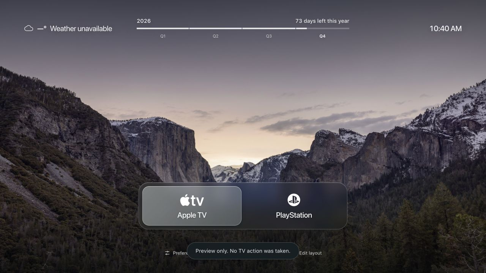

# Scenic Home for Samsung

**A vibe-coded launcher for Samsung Tizen TVs, built to replace Samsung's cluttered home screen with a calm, scenic HDMI hub.**

Open Apple TV, PlayStation or another connected device from a small row of glass cards, with landscape photography behind it and useful information up top. The goal is to keep the TV focused on your devices while retaining access to Samsung's picture, sound and system settings.

Built with Codex in plain HTML, CSS and JavaScript, then refined on a real Samsung Q80B. This is a personal experiment shared so other people and their coding agents can build on the same design.



## What this release contains

The **working visual demo**, the exact design assets and the original Q80B integration code as reference. The public demo's TV actions are intentionally disabled. Its cards do not switch HDMI, its Settings shortcut does not open native Settings, and installing it does not automatically replace the remote's Home button.

The original TV had a separate signed adapter and model-specific Home/startup configuration. To make this your everyday launcher, your agent needs to adapt and verify those controls on your TV. The instructions below distinguish the reusable design from that hardware work.

## The interface

- Eleven bundled 4K photographs from New Zealand, Vancouver, San Francisco and Yosemite, rotating every five minutes.
- Compact, frosted-glass Apple TV and PlayStation cards, with configurable names, input mappings and visibility.
- Vancouver weather, a clock, and a calendar-accurate year bar with quarter breaks and exact days remaining.
- Arrow-key/remote navigation, rounded selection and focus-only underlines on the footer controls.
- Preferences and an input-layout editor stored locally; Settings and Samsung Home entry points ready for a native adapter.

No framework, account or backend is needed for the preview. Photos and icons are local; weather is requested from Open-Meteo. There are no bundled SF Pro font files: a locally installed face is used when available, with system font fallbacks.

## Try it on your computer

Use Python 3.9 or newer:

```sh
git clone https://github.com/dvnkshl/samsung-scenic-home.git
cd samsung-scenic-home
python3 tools/preview.py
```

Open the localhost URL printed by the server. On Windows use `py -3 tools/preview.py`. Use the arrow keys, Enter and Escape, or a mouse. Stop the server with Ctrl+C.

You can also download the [friend-kit ZIP from Releases](https://github.com/dvnkshl/samsung-scenic-home/releases/latest), unzip it and run the same preview command from its folder. The initial kit uses design source **0.7.2**; the public handoff release is **1.0.0**.

## Put it on a Samsung TV

This project targets **Samsung Tizen**, not Android TV. Start with [SETUP_SAMSUNG.md](SETUP_SAMSUNG.md) to install the visual demo through Samsung's normal developer workflow. You need Developer Mode, the Samsung TV SDK and your own certificate profile covering your TV's developer DUID. The repository contains no signing credentials or ready-signed installer.

Then use the [agent prompt](AGENT_PROMPT.md) to adapt real input switching, device wake and native Settings/Home links. Keep your author key for future updates, and keep keys, tokens and device backups outside this repository.

| TV | Evidence |
| --- | --- |
| 2022 Q80B, QN65Q80BAFXZC | Original device used to refine the design and native integration; Tizen 6.5 / Chromium 85. |
| 2023 Q60C, QN75Q60CAFXZA | Intended next target. Generation is listed under Tizen 7.0; its actual installed OS and behavior still need checking. See [Q60C notes](Q60C_COMPATIBILITY.md). |
| Other Samsung models | May be suitable for the web design; native controls and firmware behavior need individual verification. |

The demo declares Tizen 6.0 or later. That minimum is not a promise that every model's native controls work. The tested Q80B renders the interface at 1920×1080 with 3840×2160 photo assets; a 4K panel does not establish a 4K web-app framebuffer.

## Replacing Samsung Home and reducing clutter

Making this the default Home screen is separate from installing an app. Home-button routing, startup behavior and cleanup depend on the TV model and firmware. [HOW_IT_WAS_BUILT.md](HOW_IT_WAS_BUILT.md) explains the original approach and its limits.

Before adapting those parts, capture your own TV's original settings, prepare a scoped undo and verify the recovery route. Keep native Settings and Samsung Home accessible. Do not copy another TV's registry or cleanup list. This release does not automatically debloat the TV or guarantee ad removal.

The experimental 30-minute idle shutdown is off in this demo; power pairing/standby and an intermittent Samsung mute overlay remained unresolved. Automatic return when an HDMI device goes offline is not implemented.

## Give it to your coding agent

Attach this repository and paste [AGENT_PROMPT.md](AGENT_PROMPT.md). The agent instructions in [AGENTS.md](AGENTS.md) cover preserving the design, identifying your TV, creating your own signing profile, adapting the controls and checking recovery before native changes.

## Source and checks

| Path | Purpose |
| --- | --- |
| `web/` | Runnable demo and exact visual assets. Start with `styles.css`, `app.js` and `scenic.js`. |
| `web/tv-bridge.js` | Inert demo adapter; replace only when implementing your own verified TV integration. |
| `reference/` | Original Q80B JavaScript, manifest and native CEC source, stored as text and excluded from the runnable widget. |
| `DESIGN.md` | Layout, materials, typography and focus rules. |
| `tools/` | Local server, integrity checker and unsigned demo packager. |
| `tests/` | Sixteen checks for demo isolation, weather and calendar behavior. |

```sh
python3 tools/verify.py
node --test tests/*.test.cjs
python3 tools/build_demo.py
```

Node.js is needed only for the tests. The packager creates an **unsigned** demo widget in `build/`; it neither installs it nor contacts a TV. Physical TV acceptance is a separate step.

## Credits

Photo sources and photographers are listed in [sources.json](web/assets/sources.json) and [CREDITS.txt](web/assets/CREDITS.txt), along with brand-mark and weather attribution. Heroicons' MIT license is retained. Third-party assets keep their own terms; this repository does not relicense them.

An independent personal project, not affiliated with Samsung, Apple or Sony.
